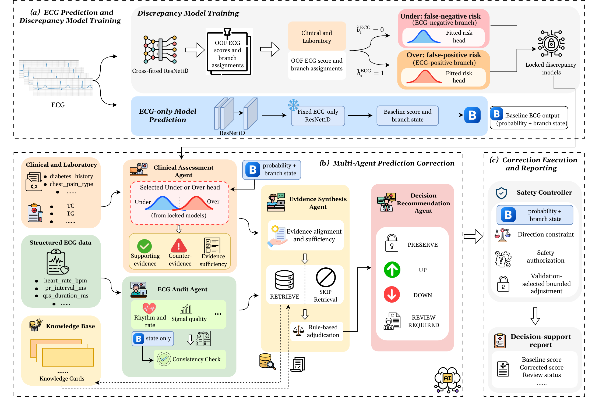

# MAVIS



MAVIS implements ECG-anchored clinical evidence assessment and bounded prediction
correction. The repository provides the inference pipeline, model training code,
and method configuration.

## Installation

Use Python 3.10–3.12 in a clean virtual environment, from this repository root:

```bash
python -m venv .venv
source .venv/bin/activate
python -m pip install -e .
# Only if training ECG models / reading raw waveforms:
python -m pip install -e '.[training]'
```

## Main method

1. A locked ResNet1D score determines the ECG baseline state and active Under/Over
   discrepancy branch.
2. ECG Audit Agent reviews structured device-report evidence. Clinical Assessment
   Agent combines the frozen supervised discrepancy head with clinical evidence.
3. Evidence Synthesis Agent applies the original deterministic Stage-A retrieval
   gate, optional local card retrieval / Stage-B assessment, and canonical rules.
4. Decision Recommendation Agent proposes a semantic action. Safety Controller
   alone normalizes direction, applies vetoes and selects the locked logit shift.

Python module names follow the paper's Agent terminology. Internal version tokens
identify the input, output, and execution contracts used by the pipeline.

## Data availability

The clinical dataset used in this study contains sensitive patient-level
information. To protect patient privacy and maintain confidentiality, the dataset
is not publicly available.

## Knowledge-card examples

The default configuration points to five literature-based knowledge-card examples
that illustrate the retrieval input format. For an evaluation, set `knowledge_cards`
in `configs/runtime.json` to the versioned JSONL corpus used for that evaluation.
Retrieved evidence and downstream outputs depend on the configured corpus.
See the [knowledge-card documentation](knowledge_base/README.md) for source IDs.

## Run on your own inputs

Place local input records under `private/` and weights under `artifacts/`, or use
paths outside the repository. The two discrepancy-model pipelines must implement
`predict_proba` and use class `1` as the positive class. Each feature schema must
contain a nonempty `features` list in model input order. The runtime derives
`oof_ecg_score` from the locked ECG score. Use trusted local joblib artifacts.
The following command binds the supplied artifacts and configuration by hash.

```bash
python -m scripts.prepare_model_bundle \
  --under-model artifacts/under.joblib --under-schema artifacts/under_schema.json \
  --over-model artifacts/over.joblib --over-schema artifacts/over_schema.json \
  --output artifacts/local_bundle
```

Copy `.env.example` to `.env` and set `LLM_API_BASE`, `LLM_API_KEY` and `LLM_MODEL`.
The client uses an OpenAI-compatible structured-output/streaming endpoint.

```bash
# Validate private input and model binding; no model forward pass or API call:
python -m scripts.run_mavis --input private/input.jsonl \
  --model-bundle artifacts/local_bundle --output outputs/local_run
# Add --execute only when ready to run your local models and make LLM calls.
```

Each executed run requires a new output directory. Keep responses and stage
artifacts in local storage because they can contain input records.

### Inference input format

Each line of the input JSONL contains one object with the following fields.

- `case_id` is a unique anonymous identifier using letters, digits, `_` or `-`.
- `ecg_anchor_context` contains `locked_ecg_score` in [0, 1] and
  `locked_ecg_threshold` matching `configs/runtime.json`.
- `agent1_ecg_evidence` or `ecg_evidence_packet` contains structured device-report
  fields. See `FORMAL_ECG_FEATURES` and `build_safe_ecg_packet` in
  `src/agents/ecg_audit_agent.py`.
- `agent2_clinical_evidence` contains structured clinical fields. See
  `FORMAL_CLINICAL_FEATURES` and `build_safe_clinical_packet` in
  `src/agents/clinical_assessment_agent.py`.

Supply label-free inference records. The input checks reject outcome, split,
phenotype and error-label fields. Use the device report as the source of ECG
statements and keep unknown clinical values distinct from explicit negatives.

If starting from waveforms, `python -m scripts.predict_ecg --help` describes the
checkpoint scoring entry point for 12-lead, 500 Hz ECGs. The preprocessing code in
`src/data_processing/waveform_dataset.py` uses 10 seconds (5,000 samples). Merge
scores with structured ECG report and clinical inputs using `case_id`.

## Training on private data

- `python -m scripts.train_ecg --help`: the original no-class-weight ResNet1D
  training loop, with user-supplied training/validation tables and output paths.
- `python -m scripts.generate_strict_ecg_oof --help`: original inner epoch selection,
  fresh outer refit and held-out ECG prediction flow. Requires a user-provided
  three-fold training-only manifest, a waveform index and training extra packages.
- `python -m scripts.train_discrepancy_models --help`: original two-head nested-CV candidate
  selection/calibration code; accepts physically separate training-only clinical,
  label and strict-OOF CSV files. No validation/test records may be passed.

Training commands require `--execute-training`. Discrepancy-model training uses
the following CSV inputs, all with `split=train`.

| Input | Fields |
| --- | --- |
| Clinical | `admission_id`, `split`, and the clinical feature columns |
| Labels | `admission_id`, `waveform_id`, `Target_CAG_Binary`, `group_label`, `split` |
| ECG OOF scores | `admission_id`, `waveform_id`, `split`, `oof_fold_id`, `ecg_score`, `ecg_oof_model`, `ecg_class_weight_strategy` |

Strict ECG OOF generation requires the label fields and `oof_fold_id` (0, 1 or 2)
in its fold manifest. The ECG index pairs `admission_id` and `waveform_id` with
`hea_path` and `dat_path`. Each record's OOF score comes from a model fitted and
selected without that record's outcome. Discrepancy-model selection reuses these
OOF scores. The configured gates, logit shifts, and thresholds are the locked
parameters for the reported study. Reproducing its results requires matching
study inputs, model artifacts, retrieval corpus, and LLM configuration.

## Layout

```text
scripts/                  Portable inference, artifact binding and training CLIs
src/agents/               Four Agent implementations, missingness handling, prompts and schemas
src/runtime/              Orchestration, strict wire format and Safety Controller
src/models/               ResNet1D architecture and locked discrepancy-head inference
src/training/             Discrepancy-model nested CV, ResNet training and strict ECG OOF
src/rag/                  Keyword retrieval and knowledge-card structures
src/llm/                  API transport and structured-output parsing
configs/                  Method parameters, no private file paths or credentials
knowledge_base/examples/  Literature-based knowledge-card examples
```

### Core modules

| Component | Source | Role |
| --- | --- | --- |
| ECG Audit Agent | `src/agents/ecg_audit_agent.py` | Reviews structured ECG report evidence. |
| Clinical Assessment Agent | `src/agents/clinical_assessment_agent.py` | Combines frozen discrepancy-model scores with clinical evidence assessment. |
| Evidence Synthesis Agent | `src/agents/evidence_synthesis_agent.py` | Builds the retrieval plan, assesses cards and derives the canonical correction relation. |
| Decision Recommendation Agent | `src/agents/decision_recommendation_agent.py` | Proposes an action from the normalized evidence view. |
| Safety Controller | `src/runtime/final_single_controller.py` | Applies action constraints, vetoes and the locked numerical correction. |
| Directional policy | `src/runtime/directional_policy.py` | Implements deterministic directional-contract checks and action normalization. |
| Missingness handling | `src/agents/missingness.py` | Classifies reported missingness for downstream evidence handling. |
| Orchestration | `src/runtime/orchestration.py` | Executes the Agent sequence and records stage outputs. |
| Discrepancy-model training | `src/training/discrepancy_training.py` | Implements training-only nested-CV selection and calibration of the two heads. |

The input keys `agent1_ecg_evidence` and `agent2_clinical_evidence`, and internal
Agent IDs `agent1` through `agent4`, remain part of the existing data contract.
They map, in order, to the four Agent names above. The Safety Controller is a
separate deterministic component, not a fifth Agent.

## Validation

The source code is distributed under the MIT license. The literature cards
retain their source attributions. This is research software, not a clinical
deployment or a verification of medical diagnoses.
